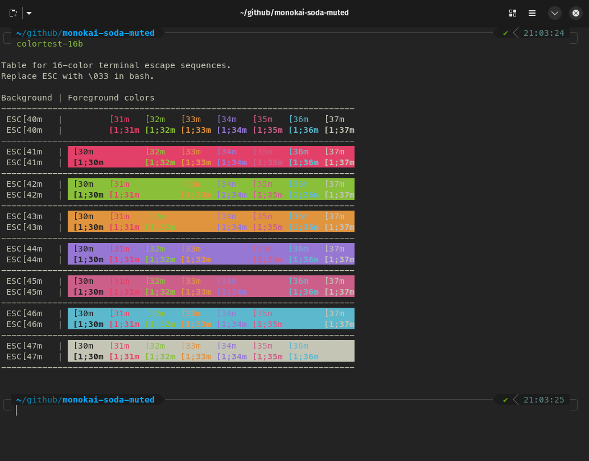
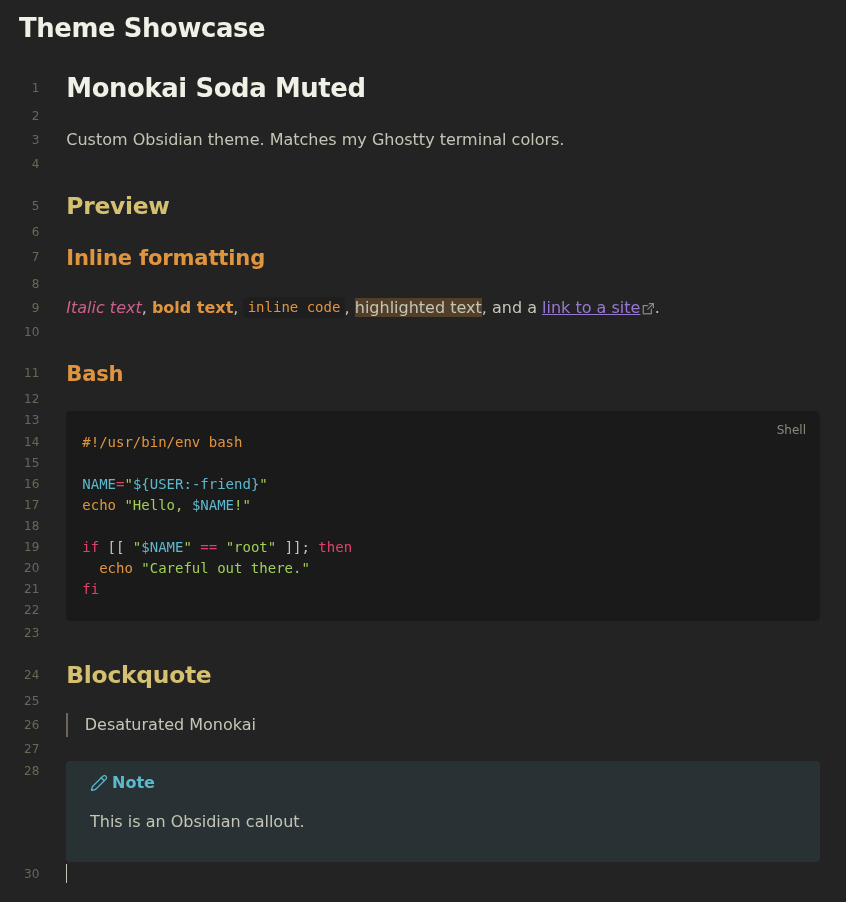

# Monokai Soda Muted

A matched pair of custom themes for [Ghostty](https://ghostty.org/) and [Obsidian](https://obsidian.md/). Based on Monokai Soda with a lifted background and toned-down accent saturation.

## Preview

**Ghostty**



**Obsidian**



## What's Included

- `ghostty/monokai-soda-muted` — Ghostty terminal theme
- `obsidian/theme.css` and `obsidian/manifest.json` — Obsidian theme
- `screenshots/obsidian-showcase.md`: sample note used for the Obsidian screenshot. It covers inline formatting, a code block, a blockquote and a callout, so you can drop it into a vault to preview the theme or retake the screenshot.

Both share the same underlying palette so your terminal and notes render in matching colors.

## Install

### Ghostty

1. Copy the theme file into Ghostty's theme directory:

   ```bash
   mkdir -p ~/.config/ghostty/themes
   cp ghostty/monokai-soda-muted ~/.config/ghostty/themes/
   ```

2. Set it in your Ghostty config (`~/.config/ghostty/config`):

   ```
   theme = monokai-soda-muted
   ```

3. Reload Ghostty (or restart it).

### Obsidian

1. Copy the theme folder into your vault's themes directory:

   ```bash
   mkdir -p <your-vault>/.obsidian/themes/
   cp -r obsidian "<your-vault>/.obsidian/themes/Monokai Soda Muted"
   ```

2. In Obsidian, go to **Settings → Appearance → Themes** and select **Monokai Soda Muted**.

## Palette

| Role         | Hex       |
|--------------|-----------|
| Background   | `#232323` |
| Foreground   | `#c4c5b5` |
| Red          | `#e24068` |
| Green        | `#8abf3a` |
| Yellow       | `#e0943e` |
| Blue/Purple  | `#9678d4` |
| Magenta      | `#cc5f8a` |
| Cyan         | `#5cb8cc` |

## License

MIT. See [LICENSE](LICENSE).
